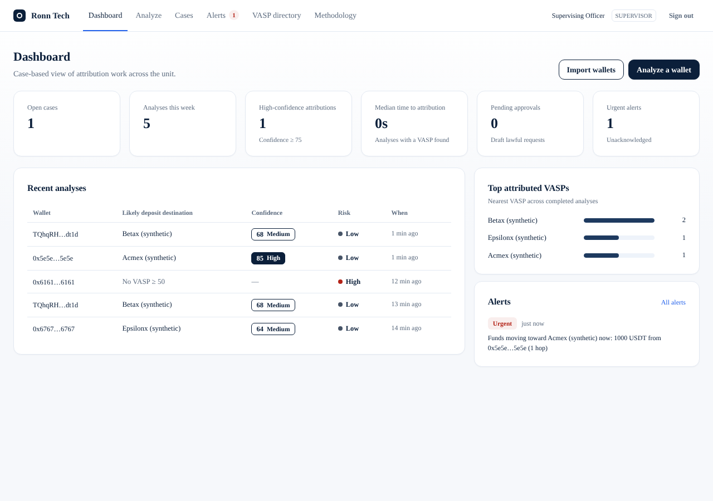
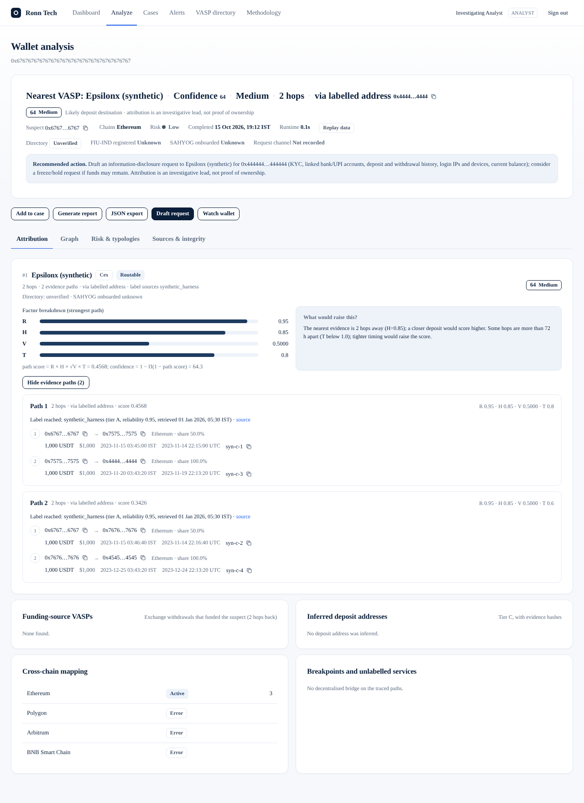
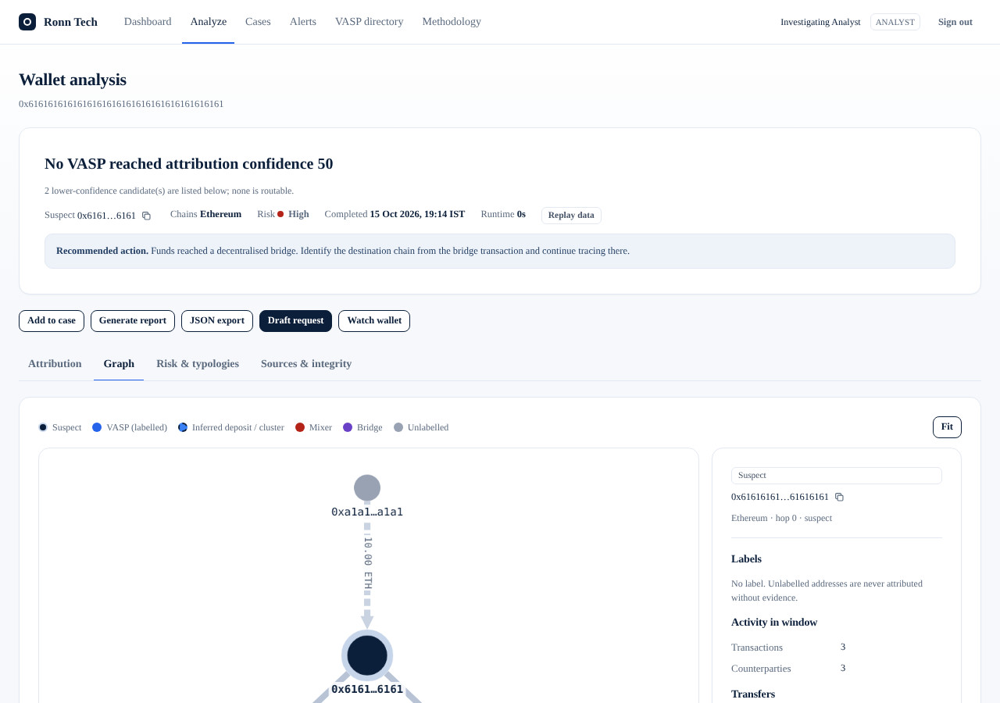
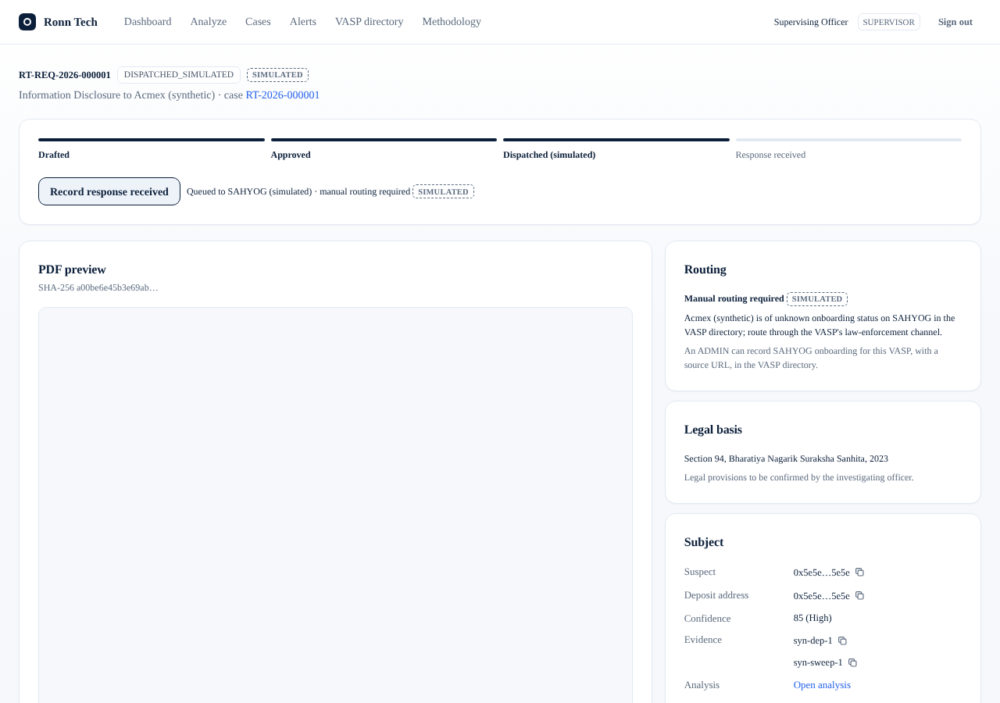

# Ronn Tech

**Automated attribution of unknown crypto wallets to the nearest VASP**, for Indian
law-enforcement investigators (I4C, CIS Division).

Given a suspect wallet (typed in, imported by CSV, or received from SAHYOG), Ronn Tech traces
where the funds went and returns, within minutes:

1. the **nearest VASP** (exchange, custodial wallet, instant-swap service) that received the
   funds, as a *likely deposit destination* with an *attribution confidence* and the exact
   on-chain *evidence* path;
2. a **risk level** with reasons and detected laundering **typologies**;
3. an **investigation-ready report** (PDF + JSON with SHA-256 integrity) and a **draft lawful
   request** routed to that VASP, approved by a second person before (simulated) dispatch.

Attribution is probabilistic and is an investigative lead, not proof of ownership. Every claim
traces to a transaction hash or to a label with a named source and retrieval time. The SAHYOG
integration is **simulated** (SAHYOG has no public API).

Product name: change `PRODUCT_NAME` in `backend/app/config.py` and `frontend/lib/product.js`.

## Quick start

Requirements: Python 3.11+, Node.js 20.9+ (Next.js 16). Works on Windows, macOS and Linux.

```bash
# Backend
cd backend
python -m venv .venv && source .venv/bin/activate      # Windows: .venv\Scripts\activate
pip install -r requirements.txt
cp .env.example .env                                   # Windows: copy .env.example .env
# edit .env: JWT_SECRET, SAHYOG_SHARED_SECRET, SEED_*_PASSWORD (>= 10 chars), API keys
python scripts/seed_users.py                           # creates admin / supervisor / analyst, loads the label seed
uvicorn app.main:app --reload                          # http://localhost:8000  (docs at /docs)

# Frontend (second terminal)
cd frontend
cp .env.local.example .env.local                       # NEXT_PUBLIC_API_URL=http://localhost:8000
npm install
npm run build && npm run dev                           # http://localhost:3000
```

Sign in as `analyst`, `supervisor` or `admin` with the passwords from `.env`.

Docker (local): copy `.env.example` to `.env` and `backend/.env.example` to `backend/.env`,
set the three seed-account passwords and both security secrets in `backend/.env`, then run
`docker compose up --build`. The app is at http://localhost:3000 and the API at
http://localhost:8000.

## Deployment

The frontend and backend are separate Docker services. Deploy them behind an HTTPS reverse
proxy or a container platform that provides HTTPS, persistent storage, and configurable
environment variables:

1. Copy `.env.example` to `.env`. Set `NEXT_PUBLIC_API_URL` to the public HTTPS URL of the
   backend (for example `https://api.example.com`) and `FRONTEND_ORIGIN` to the public HTTPS
   frontend origin (for example `https://app.example.com`). The API URL is compiled into the
   frontend image, so rebuild the frontend after changing it.
2. Copy `backend/.env.example` to `backend/.env`. Set a unique random `JWT_SECRET`, a strong
   `SAHYOG_SHARED_SECRET`, and unique `SEED_ADMIN_PASSWORD`, `SEED_SUPERVISOR_PASSWORD`, and
   `SEED_ANALYST_PASSWORD` values (at least 10 characters each). Set provider API keys as
   required for live analysis. Keep both env files out of version control.
3. Run `docker compose up --build -d`. Route the public frontend and API HTTPS origins to
   ports 3000 and 8000 respectively. The services expose health checks and restart unless
   stopped.
4. Back up the `backend-db` and `backend-evidence` volumes. SQLite is suitable for a
   single-instance deployment; configure `COMPOSE_DATABASE_URL` to use PostgreSQL before
   running multiple backend instances.

Do not expose the containers directly to the public internet without HTTPS and an appropriate
reverse proxy. `NEXT_PUBLIC_API_URL` must be reachable by users' browsers; a Docker-internal
service name such as `http://backend:8000` is not a valid public API URL. The simulated SAHYOG
integration is not a live SAHYOG connection.

Tests: `cd backend && pytest` (synthetic fixtures only, fully offline).

## API keys (backend/.env)

Missing keys never block replay mode or the tests.

| Key | Used for | Where to get it |
|---|---|---|
| `ETHERSCAN_API_KEY` | Ethereum, Polygon, Arbitrum (free tier); BNB Smart Chain is "Paid Tier Only" | register at https://etherscan.io/register, then https://etherscan.io/myapikey |
| `TRONGRID_API_KEY` | TRON (USDT-TRC20), header `TRON-PRO-API-KEY` | sign in at https://www.trongrid.io and create a key in the console |
| `TRONSCAN_API_KEY` | TRON address tags (live lookup) | https://tronscan.org/developer/api |
| `HELIUS_API_KEY` | Solana (disabled in live mode without it) | https://www.helius.dev |
| `CHAINALYSIS_API_KEY` | optional sanctions screening of the suspect | request access from Chainalysis (https://www.chainalysis.com); confirm current terms |
| `JWT_SECRET` | session tokens | `python -c "import secrets; print(secrets.token_urlsafe(48))"` |
| `SAHYOG_SHARED_SECRET` | HMAC for the simulated SAHYOG inbound webhook | any long random string |
| `SEED_ADMIN_PASSWORD`, `SEED_SUPERVISOR_PASSWORD`, `SEED_ANALYST_PASSWORD` | seeded accounts | choose (≥ 10 characters) |
| `DATABASE_URL` | empty = SQLite; or `postgresql+psycopg://…` | — |
| `DATA_MODE` | `live` (default), `record`, `replay` (offline) | — |

## Demo cases and data modes

- `live` calls the real APIs; `record` also saves every raw response to
  `backend/fixtures/<chain>/<sha256>.json` (keys stripped); `replay` serves only from fixtures,
  fully offline.
- The five demo cases come from real chain data:
  `python scripts/build_ground_truth.py` finds them and `python scripts/record_fixtures.py`
  records them and writes the measured results to [docs/DEMO_CASES.md](docs/DEMO_CASES.md).
  This repository was built without network access to the chain APIs, so **the fixtures are
  not recorded yet**: run these two commands once with API keys.

| # | Demo case | Expected result |
|---|---|---|
| 1 | Direct deposit to an inferred exchange deposit address (Ethereum) | nearest VASP at 1 hop via inferred deposit address |
| 2 | Multi-hop USDT-TRC20 path to a labelled exchange (TRON) | nearest VASP at 2–3 hops |
| 3 | Bitcoin case resolved by common-input clustering | nearest VASP via common-input cluster |
| 4 | Path ending at a mixer or bridge breakpoint | breakpoint reported, MIXER_EXPOSURE or CROSS_CHAIN_BREAKPOINT |
| 5 | Honest no-match | no VASP at confidence ≥ 50 |

The 5-minute walkthrough is in [docs/DEMO_SCRIPT.md](docs/DEMO_SCRIPT.md).

## Screenshots

Rendered from **synthetic test data** (fabricated "(synthetic)" exchanges) in a development
harness, before real fixtures were recorded; the production build uses Inter and JetBrains Mono.

| Dashboard | Analysis result |
|---|---|
|  |  |
| **Fund-flow graph** | **Lawful request (simulated dispatch)** |
|  |  |

## Documentation

| Document | Contents |
|---|---|
| [SPEC.md](SPEC.md) | the project specification |
| [docs/TRACEABILITY.md](docs/TRACEABILITY.md) | every requirement → module, endpoint, screen, tests |
| [docs/ARCHITECTURE.md](docs/ARCHITECTURE.md) | components, data flow, production scale path |
| [docs/METHODOLOGY.md](docs/METHODOLOGY.md) | heuristics with sources, scoring formula, limitations |
| [docs/DATA_SOURCES.md](docs/DATA_SOURCES.md) | label sources, licences, refresh commands, providers |
| [docs/SAHYOG_INTEGRATION.md](docs/SAHYOG_INTEGRATION.md) | simulated adapter: payloads, HMAC signature, sequence |
| [docs/EVALUATION.md](docs/EVALUATION.md) | evaluation method and measured results |
| [docs/DEMO_SCRIPT.md](docs/DEMO_SCRIPT.md) | stakeholder walkthrough |

## Repository layout

```
backend/   FastAPI app (app/), config/ (scoring, tokens, chains, legal), scripts/, eval/, fixtures/, tests/
frontend/  Next.js App Router (JavaScript, plain CSS, Cytoscape)
docs/      documentation
```

## What the team must verify

- **Legal provisions** in `backend/config/legal.yaml` — legal provisions to be confirmed by the
  investigating officer.
- **VASP directory facts** — FIU-IND registration, SAHYOG onboarding and law-enforcement
  request channels are unknown until an ADMIN records them with a source URL.
- **Token contracts** in `backend/config/tokens.yaml` marked `verified: false`.
