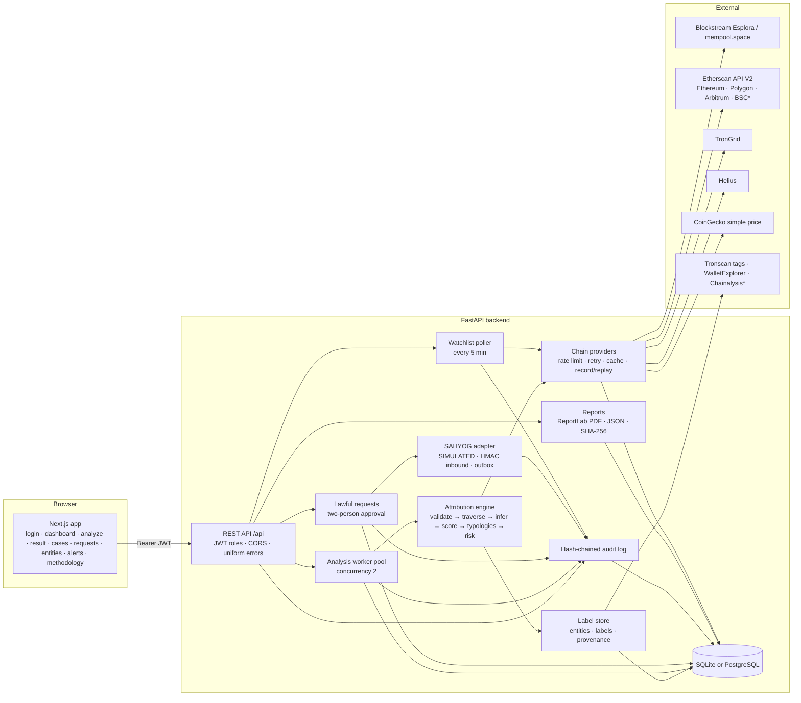

# Architecture

Ronn Tech is a FastAPI backend and a Next.js (App Router) frontend. The backend owns every
external call, every API key and every hash; the browser only talks to `/api` with a
60-minute JWT.

## Components



`*` BSC is "Paid Tier Only" on Etherscan and is shown as *requires paid plan*; Chainalysis
is used only when its key is set.

## Data flow of one analysis

```mermaid
sequenceDiagram
  participant O as Officer (browser)
  participant A as API
  participant W as Worker
  participant P as Providers
  participant L as Labels
  participant D as Database
  O->>A: POST /api/analyses {address}
  A->>A: validate (checksums) → 400 with reason if invalid
  A->>D: analysis row (queued) + audit
  A-->>O: 202 {id}
  A->>W: submit
  W->>P: suspect history on each candidate chain (EVM: all enabled chains in parallel)
  P-->>W: transfers (+ raw response SHA-256, saved as evidence)
  W->>L: hop-0 labels, deposit inference on the suspect
  loop BFS to max hops (top 5 counterparties + any ≥ 10 % of outflow)
    W->>P: counterparty history (from the entry block/time)
    W->>L: labels; sweep test / common-input clustering
  end
  W->>W: score paths, typologies, risk, breakpoints
  W->>D: result JSON + SHA-256, raw-response index, tier-C labels, audit
  O->>A: GET /api/analyses/{id} (polled every 1.5 s)
  A-->>O: stage, progress, result
```

## Storage

| Table | Purpose |
|---|---|
| `users`, `audit_log` | accounts (bcrypt) and the hash-chained audit trail |
| `entities`, `labels`, `label_source_runs` | VASP directory, address labels with source/tier/retrieval time, ingestion provenance |
| `provider_cache`, `raw_responses` | 10-minute response cache; per-analysis evidence index (URL, SHA-256, time, origin) |
| `analyses`, `report_records` | results and their hashes; hashes of every generated report |
| `cases`, `case_wallets`, `case_events` | case management and timeline |
| `lawful_requests`, `sahyog_outbox`, `sahyog_inbound` | requests, simulated SAHYOG messages |
| `watchlist`, `alerts` | watched wallets and alerts |

Raw provider responses are also written to `backend/evidence/<analysis id>/` and, in record
mode, to `backend/fixtures/<chain>/<sha256(url)>.json` with API keys stripped.

## Production scale path

The prototype runs on one machine. To handle large volumes (thousands of SAHYOG cases a day):

1. **PostgreSQL** — set `DATABASE_URL=postgresql+psycopg://…`; SQLAlchemy models are portable.
   Add Alembic migrations, partition `raw_responses` and `audit_log` by month.
2. **Job queue** — replace the in-process thread pool (`app/engine/jobs.py`) with a durable
   queue (Redis + RQ/Celery, or PostgreSQL `SKIP LOCKED`), with per-chain worker pools sized to
   provider rate limits, retries and dead-lettering. The watchlist poller becomes a scheduled job.
3. **Graph database** — persist traced edges across analyses (Neo4j or PostgreSQL + Apache AGE)
   so repeated hops are reused, linked wallets surface across cases, and inferred deposit
   addresses accumulate as an internal label set.
4. **Self-hosted nodes and indexers** — Bitcoin Core + electrs, Erigon/Reth with an indexer
   for ERC-20 transfers, a TRON FullNode with event indexing, and a Solana RPC + Geyser
   indexer remove third-party rate limits and data-sharing concerns, and allow historical
   prices at transfer time.
5. **Object storage for evidence** — write raw responses and reports to WORM (write once,
   read many) storage with retention locks; keep only hashes and pointers in the database.
6. **Separation of duties** — run the SAHYOG adapter as a separate service with its own
   credentials, network policy and audit sink once an official interface exists.
7. **Observability** — per-provider latency and error dashboards, queue depth, and alerting
   on audit-chain verification failures.
