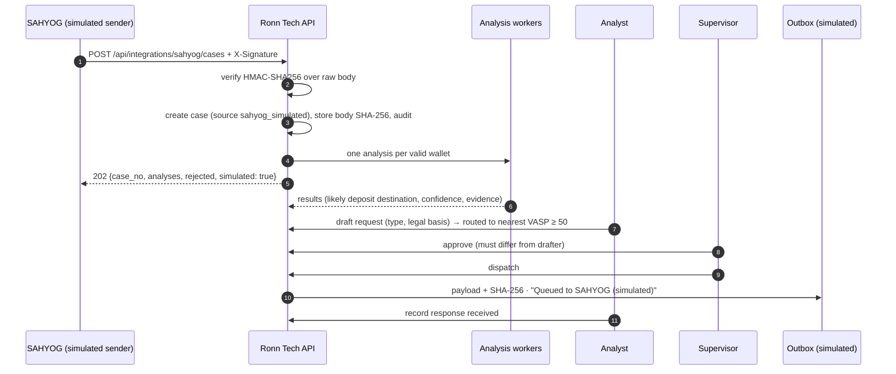

# SAHYOG integration (simulated)

**SAHYOG has no public API.** This adapter is a documented stand-in so the end-to-end flow can
be demonstrated. It is labelled "Simulated" everywhere it appears (UI tags, API responses with
`"simulated": true`, PDF banner, outbox status). Nothing is ever sent to a real system.

Code: `backend/app/integrations/sahyog.py`, `backend/app/api/integrations.py`,
`backend/app/lawful_requests/service.py`, demo sender `backend/scripts/simulate_sahyog_case.py`.

## Inbound: case reported on SAHYOG

`POST /api/integrations/sahyog/cases` — not Bearer-authenticated; authenticated by signature.

### Payload

```json
{
  "sahyog_ref": "SAHYOG-2026-000123",
  "agency": "Cyber Crime Police Station, <district>",
  "officer": "SI <name>",
  "complaint_ref": "<NCRP acknowledgement number>",
  "wallets": [
    {"address": "<suspect wallet>", "chain_hint": "tron"},
    {"address": "<suspect wallet>", "chain_hint": null}
  ]
}
```

| Field | Type | Rules |
|---|---|---|
| `sahyog_ref` | string, 1–64 | idempotency key: a repeated ref returns the existing case (`"status": "duplicate"`) |
| `agency`, `officer` | string, 1–128 | stored on the case |
| `complaint_ref` | string ≤ 64, optional | e.g. the NCRP acknowledgement number |
| `wallets` | 1–100 items | each validated with checksums; invalid wallets are listed in `rejected` and on the case timeline |

### Signature

```
X-Signature: <hex HMAC-SHA256(raw request body, SAHYOG_SHARED_SECRET)>
```

A `sha256=` prefix is accepted. The comparison is constant-time and covers the exact raw bytes
received, so any change to the body invalidates the signature. Missing or wrong signatures
return 401 (`signature_missing`, `signature_invalid`); an unconfigured secret returns 503
(`sahyog_not_configured`); a malformed body returns 400/422.

### Response (202)

```json
{
  "status": "accepted",
  "case_id": 12,
  "case_no": "RT-2026-000012",
  "analyses": [{"analysis_id": "…", "address": "…", "chain_hint": "tron"}],
  "rejected": [{"address": "0x1234", "chain_hint": "ethereum", "reason": "EVM address must be 0x followed by 40 hex characters."}],
  "simulated": true
}
```

A case is created with `source = sahyog_simulated`, the body's SHA-256 is stored in
`sahyog_inbound`, one analysis per valid wallet starts automatically, and the case moves
NEW → ANALYZING → REVIEW when the analyses finish.

## Outbound: lawful request dispatch

A request is drafted by an ANALYST, approved by a **different** SUPERVISOR, then dispatched.
Dispatch writes the payload below to the `sahyog_outbox` table with status
`Queued to SAHYOG (simulated)` (plus `· manual routing required` when the VASP is not recorded
as onboarded). Its SHA-256 is stored and audit-logged.

```json
{
  "schema": "ronn-tech/sahyog-outbound/v1",
  "simulated": true,
  "sender": "Ronn Tech",
  "request_no": "RT-REQ-2026-000001",
  "request_type": "INFORMATION_DISCLOSURE",
  "legal_basis": {"id": "bnss_94", "label": "Section 94, Bharatiya Nagarik Suraksha Sanhita, 2023", "note": "Legal provisions to be confirmed by the investigating officer."},
  "case": {"case_no": "RT-2026-000012", "complaint_ref": "…", "fir_no": "…", "agency": "…", "sahyog_ref": "…"},
  "vasp": {"entity_id": 42, "name": "<exchange>", "le_request_channel": null, "sahyog_onboarded": null},
  "routing": "Manual routing required",
  "subject": {
    "suspect_address": "…", "deposit_address": "…", "chain": "tron",
    "attribution_confidence": 85.0, "tier": "High",
    "evidence_tx_hashes": ["…"], "analysis_sha256": "…"
  },
  "items_requested": ["KYC records …", "Linked bank accounts and UPI IDs …", "…"],
  "approved_by": "supervisor", "approved_at": "2026-10-15T10:00:00Z",
  "drafted_by": "analyst", "notes": ""
}
```

Routing: the request goes to the nearest-VASP entity only when its attribution confidence is
≥ 50. If that entity's `sahyog_onboarded` is false or unknown, the request is marked
**Manual routing required**. Only an ADMIN can record onboarding, and only with a source URL.

## Sequence



## Try it

```
cd backend
python scripts/simulate_sahyog_case.py --api http://localhost:8000          # wallets from fixtures/demo_cases.json
python scripts/simulate_sahyog_case.py --wallet <address>:tron --ref SAHYOG-DEMO-0002
```
